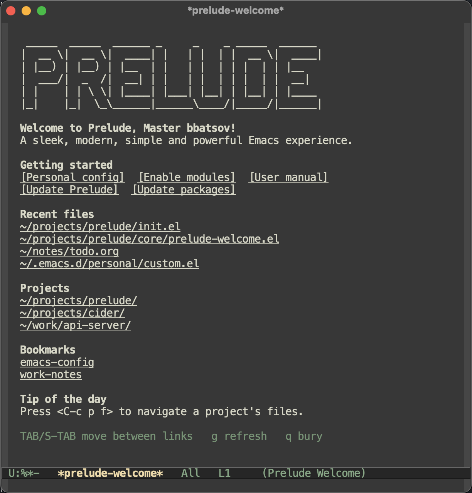

# Getting Started

You've [installed](installation.md) Prelude and started Emacs. Now
what?

## The first start

The first start takes a while, as Prelude downloads the packages it's
built on. That happens only once.

When it's done you're looking at the welcome screen. Its links take you
to the things you'll want in your first hour: your personal config, the
list of modules, this manual. You can always get back to it with
<kbd>M-x prelude-welcome</kbd>, and turn it off for good with
`prelude-welcome-screen` (see [Configuration](configuration.md)).



If you're new to Emacs itself, do the built-in tutorial first
(<kbd>C-h t</kbd>). Prelude changes a lot of defaults, but the basics
are the same. If you know Emacs well,
[Differences from Stock Emacs](differences.md) tells you what's going
to surprise you.

## Pick your modules

Out of the box Prelude is an editor with good defaults. Support for
programming languages (and a few other things) comes in
[modules](modules/index.md), and you decide which ones are loaded.

The list is in `personal/prelude-modules.el`. If you used the
installer, the file is there already. Otherwise copy
`sample/prelude-modules.el` to `personal/` first - until you do,
Prelude runs with the sample file, which you shouldn't edit.

To enable a module, uncomment its line:

```emacs-lisp
(require 'prelude-python)
```

and restart Emacs (or evaluate the line with <kbd>C-x C-e</kbd>). The
module's packages are installed the first time it's loaded.

A few choices are made in that file as well:

- **The completion UI** for commands, files and buffers.
  [Vertico](modules/vertico.md) is the default; Helm, Ivy and Ido are
  the alternatives. Enable only one of them.
- **Completion as you type.** [Company](modules/company.md) is the
  default, [Corfu](modules/corfu.md) the lighter alternative.

## Set up a language

Open a file in a language whose module you've enabled and two things
may happen.

Prelude may offer to install a *tree-sitter grammar*. Say yes: that's
what gives you the modern, more accurate major mode for the language.
It needs a C compiler on your system (see
[Tree-sitter grammars](configuration.md#tree-sitter-grammars)).

Prelude may also tell you that there's no language server:

```text
[Prelude] No language server for 'python-ts-mode' buffers: ...
```

Code completion, navigation and on-the-fly errors come from a language
server that you install yourself. The page of each module says which
one to get, and the [LSP](modules/lsp.md) page explains how it all fits
together. Editing works fine without one, so there's no rush.

## Make it yours

Your own configuration goes in the `personal/` directory, in as many
`.el` files as you like. Prelude never touches that directory, so
updates won't clash with your changes. <kbd>C-c I</kbd> takes you
there.

```emacs-lisp
;;; personal/settings.el
(setq-default fill-column 100)
(global-set-key (kbd "C-c z") #'zap-up-to-char)
```

Prelude's own options (the theme, the LSP client, etc.) are a special
case: most of them have to be set before Prelude loads, in
`personal/preload/`, or with <kbd>M-x customize-group RET prelude</kbd>.
The [Configuration](configuration.md) page has the list.

## Keys worth learning first

| Key | What it does |
| --- | ------------ |
| <kbd>C-c p f</kbd> | Find a file in the current project |
| <kbd>C-c p p</kbd> | Switch to another project |
| <kbd>C-x g</kbd> | Git, by way of Magit |
| <kbd>C-c f</kbd> | Reopen a recently visited file |
| <kbd>C-=</kbd> | Select the thing at point, then more of it |
| <kbd>C-c n</kbd> | Clean up the indentation and whitespace of the buffer |
| <kbd>C-h k</kbd> | Tell me what a key does |

The [Usage](usage.md) page has the rest, with a few screencasts.
Prelude also shows you a tip every time it starts.

## Staying up to date

<kbd>M-x prelude-update</kbd> updates Prelude and its packages. Restart
Emacs afterwards.

## When something goes wrong

Start with [Troubleshooting](troubleshooting.md) and the [FAQ](faq.md).
If that doesn't help, see [Support](support.md).
