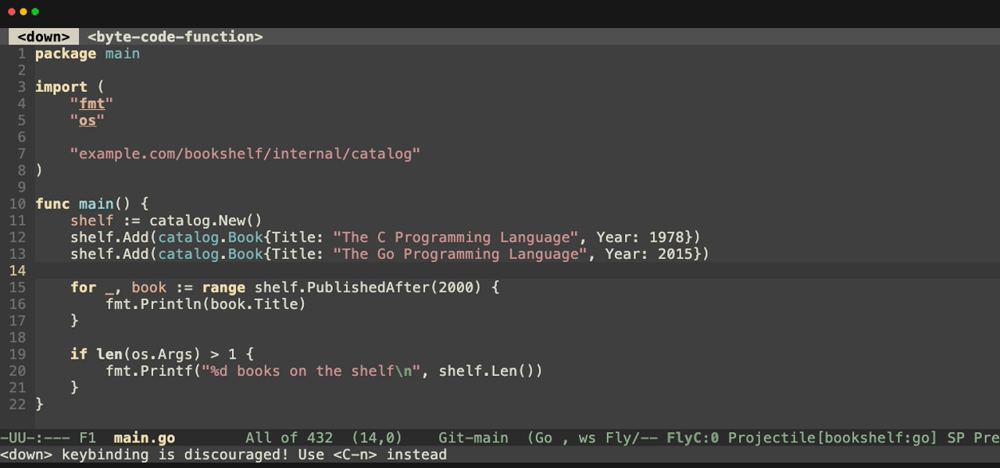

# Prelude Go

!!! Note

    This module builds on top of the shared [Programming](programming.md)
    module and the [LSP](lsp.md) module.

## Package Prerequisites

You'll need Go and its language server,
[gopls](https://github.com/golang/tools/tree/master/gopls):

```shell
go install golang.org/x/tools/gopls@latest
```

Make sure that `gopls` is on your `PATH` (it ends up in `~/go/bin` by
default).
[goimports](https://pkg.go.dev/golang.org/x/tools/cmd/goimports) is
optional, but nice to have (see [Formatting](#formatting)).

## Go Mode

The module uses the tree-sitter powered `go-ts-mode` that comes with
Emacs. Prelude offers to install the `go` grammar the first time you
open a Go file (see `prelude-treesit-auto-install`). Without the
grammar you get [go-mode](https://github.com/dominikh/go-mode.el).

`go-mode` is installed in both cases, as it's the home of `gofmt`,
`godoc` and a few other commands that Prelude uses. Everything
described here works the same way in both modes.

`subword-mode` is enabled, so the editing commands understand
`CamelCase`. Tabs aren't highlighted by `whitespace-mode`, as that's
how Go code is indented.

## Formatting

The buffer is formatted with `gofmt` when you save it. If `goimports`
is installed it's used instead, so your imports get updated as well.
To turn that off:

```emacs-lisp
(setq prelude-format-on-save nil)
```

<!-- markdownlint-disable MD013 -->



<!-- markdownlint-enable MD013 -->

Prelude leaves the formatting to [Apheleia](apheleia.md) when that
module is enabled (it prefers `goimports` as well).

Go buffers are not saved automatically by `super-save`, as saving
formats the code and you don't want that to happen while you're in the
middle of typing something.

## Key Bindings

<!-- markdownlint-disable MD013 -->

| Key | Command | Description |
| --- | ------- | ----------- |
| <kbd>C-c C-t t</kbd> | `go-test-current-test` | Run the test at point |
| <kbd>C-c C-t f</kbd> | `go-test-current-file` | Run the tests in the current file |
| <kbd>C-c C-t p</kbd> | `go-test-current-project` | Run the tests of the current package |
| <kbd>C-c C-r</kbd> | `go-run` | Run the current file |
| <kbd>C-h G</kbd> | `godoc` | Show the documentation of a package |

<!-- markdownlint-enable MD013 -->

The test commands come from
[gotest](https://github.com/nlamirault/gotest.el).

See the [LSP](lsp.md) module for the available LSP key bindings.
