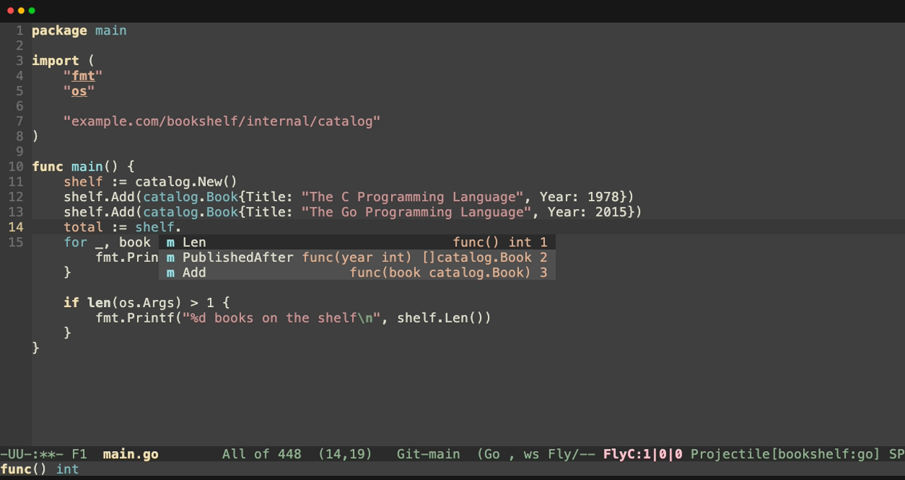
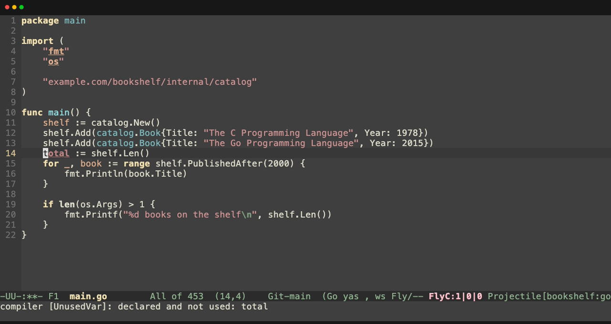

# Prelude LSP

## Overview

Prelude supports two LSP clients, controlled by the
`prelude-lsp-client` variable:

- **Eglot** (default) - built into Emacs 29+, lightweight,
  zero extra dependencies
- **lsp-mode** - feature-rich third-party client with lsp-ui
  (peek views, sideline diagnostics, doc overlays)

Language modules that support LSP (Go, Rust, Scala, Dart,
etc.) automatically use whichever client you've configured.

## Choosing an LSP Client

The default is Eglot. To switch to lsp-mode, add to your
`personal/preload/` config:

```emacs-lisp
(setq prelude-lsp-client 'lsp-mode)
```

## Eglot

[Eglot](https://github.com/joaotavora/eglot) is built into
Emacs 29+ and works out of the box with most language servers.
It uses standard Emacs facilities (xref, eldoc, flymake,
completion-at-point) rather than introducing its own UI.

Prelude configures eglot to shut down language servers
automatically when the last project buffer is closed, and to keep
managing the files outside of the project that xref takes you to
(e.g. the source of a library), so you can keep jumping around from
there.

Here's a Go buffer with `gopls` attached. The candidates in the
completion popup come from the language server, and so does the
signature in the echo area:

<!-- markdownlint-disable MD013 -->



<!-- markdownlint-enable MD013 -->

Problems are underlined as you type. Move the cursor to one of them
to see what the language server (or the compiler) has to say:

<!-- markdownlint-disable MD013 -->



<!-- markdownlint-enable MD013 -->

### Key Bindings

Standard Emacs bindings that work with eglot:

- <kbd>M-.</kbd> - find definition (xref)
- <kbd>M-?</kbd> - find references (xref)
- <kbd>C-h .</kbd> - documentation at point (eldoc)

Prelude additions under the <kbd>C-c L</kbd> prefix:

<!-- markdownlint-disable MD013 -->

| Key | Command | Description |
| --- | ------- | ----------- |
| <kbd>C-c L r</kbd> | `eglot-rename` | Rename symbol |
| <kbd>C-c L e</kbd> | `eglot-code-actions` | Code actions |
| <kbd>C-c L f</kbd> | `eglot-format-buffer` | Format buffer |
| <kbd>C-c L o</kbd> | `eglot-code-action-organize-imports` | Organize imports |

<!-- markdownlint-enable MD013 -->

## lsp-mode

When `prelude-lsp-client` is set to `lsp-mode`, the
`prelude-lsp-mode` module is loaded automatically. It installs
[lsp-mode](https://emacs-lsp.github.io/lsp-mode/) and
[lsp-ui](https://emacs-lsp.github.io/lsp-ui/).

### lsp-mode Key Bindings

All lsp-mode key bindings use the <kbd>C-c L</kbd> prefix:

<!-- markdownlint-disable MD013 -->

| Key | Command | Description |
| --- | ------- | ----------- |
| <kbd>C-c L .</kbd> | `lsp-ui-peek-find-definitions` | Peek at definition |
| <kbd>C-c L ?</kbd> | `lsp-ui-peek-find-references` | Peek at references |
| <kbd>C-c L r</kbd> | `lsp-rename` | Rename symbol |
| <kbd>C-c L x</kbd> | `lsp-workspace-restart` | Restart workspace |
| <kbd>C-c L w</kbd> | `lsp-ui-peek-find-workspace-symbol` | Find symbol |
| <kbd>C-c L i</kbd> | `lsp-ui-peek-find-implementation` | Find implementation |
| <kbd>C-c L d</kbd> | `lsp-describe-thing-at-point` | Describe at point |
| <kbd>C-c L e</kbd> | `lsp-execute-code-action` | Code action |
| <kbd>C-c L f</kbd> | `lsp-format-buffer` | Format buffer |
| <kbd>C-c L o</kbd> | `lsp-organize-imports` | Organize imports |
| <kbd>C-c L m</kbd> | `lsp-ui-imenu` | LSP imenu |

<!-- markdownlint-enable MD013 -->

## Installing Language Servers

Regardless of which client you use, you need the appropriate
language server installed on your system. When it's missing Prelude
doesn't start Eglot at all, and tells you so the first time you open a
file of that kind:

```text
[Prelude] No language server for ‘zig-mode’ buffers: ‘zls’ isn't installed
```

Once the server is installed, run <kbd>M-x eglot</kbd> (or reopen the file).
Common examples:

- **Go**: `gopls` (`go install golang.org/x/tools/gopls@latest`)
- **Rust**: `rust-analyzer`
- **Scala**: `metals`
- **Python**: `pyright` or `pylsp`
- **Dart**: Dart SDK includes its analysis server
- **Java**: installed automatically by the [Java](java.md) module
