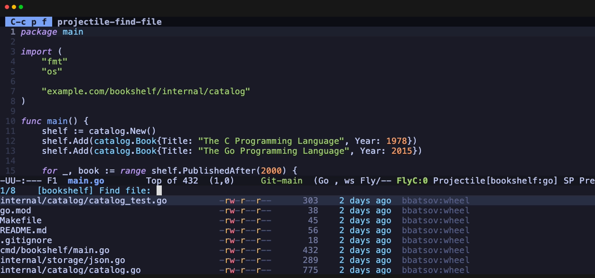

# Prelude Vertico

!!! Note

    This module is enabled by default.

## Overview

[Vertico](https://github.com/minad/vertico) is a minimalistic vertical
completion UI for Emacs. This module sets up Vertico together with complementary
packages for a modern and lightweight completion experience.

Every command that asks you to pick something gets the same vertical
list, narrowed down as you type. Here it is for the files of a
project (<kbd>C-c p f</kbd>):

<!-- markdownlint-disable MD013 -->

<!-- markdownlint-enable MD013 -->

!!! Note

    This module is an alternative to the [Helm](helm.md), [Ido](ido.md),
    [Ivy](ivy.md) modules - you should
    only enable one completion framework.

## Packages

- [vertico](https://github.com/minad/vertico) - the vertical completion UI
- [orderless](https://github.com/oantolin/orderless) - flexible
  completion style (space-separated patterns)
- [marginalia](https://github.com/minad/marginalia) - rich annotations
  in the minibuffer (docstrings, file sizes, etc.)
- [consult](https://github.com/minad/consult) - enhanced versions
  of built-in commands
- [embark](https://github.com/oantolin/embark) - a keyboard-driven
  context menu for candidates and things at point
- [embark-consult](https://github.com/oantolin/embark) - integration
  between Embark and Consult

## Consult Key Bindings

Consult provides many enhanced commands. Here are the key bindings configured by
Prelude:

### Buffer and File Navigation

| Key | Command | Description |
| --- | ------- | ----------- |
| <kbd>C-x b</kbd> | `consult-buffer` | Enhanced buffer switching |
| <kbd>C-x 4 b</kbd> | `consult-buffer-other-window` | Buffer in other window |
| <kbd>C-x 5 b</kbd> | `consult-buffer-other-frame` | Buffer in other frame |
| <kbd>M-y</kbd> | `consult-yank-pop` | Browse kill ring |
| <kbd>C-x M-:</kbd> | `consult-complex-command` | Repeat a complex command |

### Navigation (M-g prefix)

| Key | Command | Description |
| --- | ------- | ----------- |
| <kbd>M-g g</kbd>, <kbd>M-g M-g</kbd> | `consult-goto-line` | Go to line |
| <kbd>M-g o</kbd> | `consult-outline` | Navigate outline headings |
| <kbd>M-g m</kbd> | `consult-mark` | Navigate marks |
| <kbd>M-g k</kbd> | `consult-global-mark` | Navigate global marks |
| <kbd>M-g i</kbd> | `consult-imenu` | Navigate imenu |
| <kbd>M-g I</kbd> | `consult-imenu-multi` | Navigate imenu across buffers |

### Search (M-s prefix)

| Key | Command | Description |
| --- | ------- | ----------- |
| <kbd>M-s l</kbd> | `consult-line` | Search lines in buffer |
| <kbd>M-s L</kbd> | `consult-line-multi` | Search lines across buffers |
| <kbd>M-s g</kbd> | `consult-grep` | Grep |
| <kbd>M-s G</kbd> | `consult-git-grep` | Git grep |
| <kbd>M-s r</kbd> | `consult-ripgrep` | Ripgrep |
| <kbd>M-s f</kbd> | `consult-find` | Find files |
| <kbd>M-s F</kbd> | `consult-locate` | Locate files |
| <kbd>M-s k</kbd> | `consult-keep-lines` | Keep matching lines |
| <kbd>M-s u</kbd> | `consult-focus-lines` | Focus on matching lines |
| <kbd>M-s m</kbd> | `multi-occur` | Search several buffers with `occur` |

### Registers

| Key | Command | Description |
| --- | ------- | ----------- |
| <kbd>M-#</kbd> | `consult-register-load` | Load register |
| <kbd>M-'</kbd> | `consult-register-store` | Store register |
| <kbd>C-M-#</kbd> | `consult-register` | Browse registers |

## In the Minibuffer

When you pick a file, <kbd>RET</kbd> on a directory goes into it,
<kbd>DEL</kbd> deletes a whole directory of the path at once and
<kbd>M-DEL</kbd> a word of it (that's the `vertico-directory`
extension).

Consult's commands that list several kinds of candidates (e.g.
`consult-buffer`) can be narrowed down to one of them: type
<kbd>&lt;</kbd> followed by the key of the group (e.g. <kbd>&lt; b</kbd>
for buffers), and <kbd>&lt;</kbd> again to widen.

## Completion Style

The module configures the `orderless` completion style, which allows you to
type space-separated patterns that can match in any order. For example, typing
`buf swi` would match `switch-to-buffer`.

## Acting on Candidates with Embark

[Embark](https://github.com/oantolin/embark) is a keyboard-driven context
menu. Point it at a minibuffer candidate or a thing at point (a file, a URL, a
symbol, ...) and it offers the actions that make sense for it.

| Key | Command | Description |
| --- | ------- | ----------- |
| <kbd>C-.</kbd> | `embark-act` | Act on the thing at point or candidate |
| <kbd>C-;</kbd> | `embark-dwim` | Run the default action directly |
| <kbd>C-h B</kbd> | `embark-bindings` | Browse the bindings at point |

A particularly handy trick is `embark-export`: from a `consult-ripgrep` (or
`consult-line`, etc.) session you can export the whole candidate set into a
proper `grep`/`occur` buffer. You can edit an `occur` buffer in place
with <kbd>e</kbd>, and a `grep` one with the
[wgrep](https://github.com/mhayashi1120/Emacs-wgrep) package (which
Prelude doesn't install).

!!! Note

    <kbd>C-.</kbd> and <kbd>C-;</kbd> are also bound by `flyspell-mode`
    (auto-correct), so in buffers where Prelude enables Flyspell those keys
    keep their Flyspell meaning. Embark still works everywhere else, including
    the minibuffer, which is where you'll use it most with Vertico and Consult.
    Switch to the `jinx` spell checker (see `prelude-spell-checker`), or rebind
    the keys, if you'd rather have Embark at point in prose buffers too.
