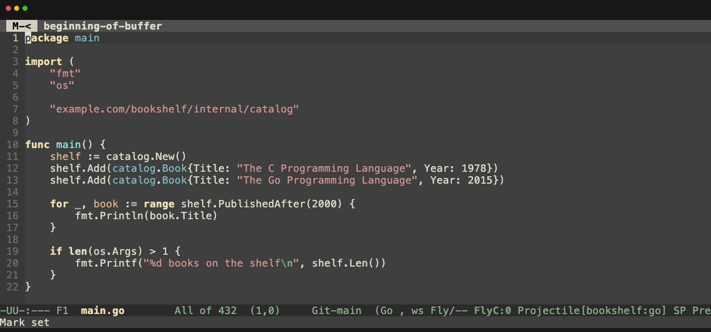
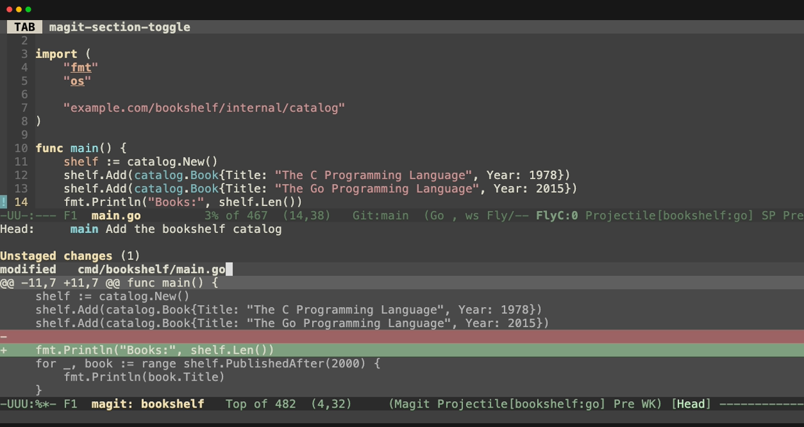
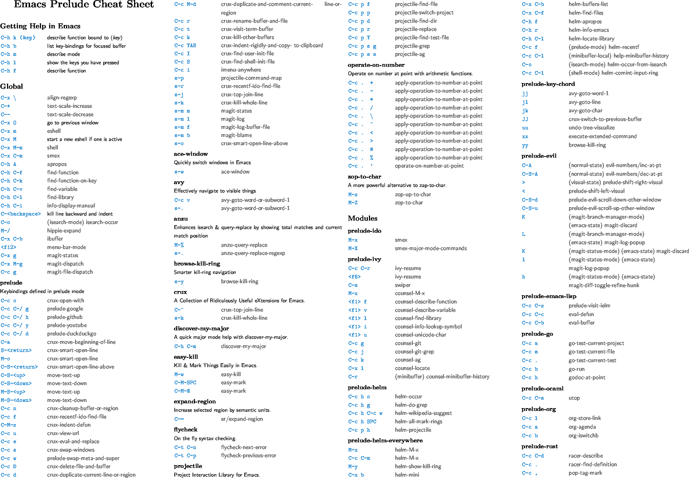

# Usage

## Running

Nothing fancy here. Just start Emacs as usual. Personally I run Emacs
in daemon mode:

```shell
emacs --daemon
```

Afterwards I connect to the server with either a terminal or a GUI
client like this:

```shell
emacsclient -t
emacsclient -c
```

You'd probably do well to put a few aliases in your `.zshrc` (or
`.bashrc`):

```bash
alias e='emacsclient -t'
alias ec='emacsclient -c'
alias vim='emacsclient -t'
alias vi='emacsclient -t'
```

The last two aliases are helpful if you're used to editing files from
the command line using `vi(m)`.

You can also open a file with the cursor positioned directly
on a specific line:

```shell
emacsclient somefile:1234
```

This will open file `somefile` and set cursor on line 1234.

## Getting to know Prelude

Certainly the best way to understand how Prelude enhances the default
Emacs experience is to peruse Prelude's source code (which is
obviously written in Emacs Lisp). Understanding the code is not
necessary of course. Prelude includes a `prelude-mode` minor Emacs mode
which collects some of the additional functionality added by
Prelude. It also adds an additional keymap that binds many of those
extensions to keybindings.

### Keymap

Keys are written the way Emacs itself shows them (try
<kbd>C-h k</kbd>): `C-` is Control, `M-` is Meta (Alt or Option), `S-`
is Shift and `s-` is Super (the Windows or Command key).

#### Global

These bindings are available everywhere.

<!-- markdownlint-disable MD013 -->

Keybinding | Command | Description
-----------|---------|------------
<kbd>C-x \\</kbd> | `align-regexp` | Align the region on a regular expression.
<kbd>C-^</kbd> | `crux-top-join-line` | Join the current line with the one below it.
<kbd>C-x m</kbd> | `eshell` | Start Eshell, or switch to it.
<kbd>C-x M-m</kbd> | `shell` | Start your default shell.
<kbd>C-x C-m</kbd> | `execute-extended-command` | An alias for <kbd>M-x</kbd> that doesn't need Meta.
<kbd>C-h A</kbd> | `apropos` | Search in all Emacs symbols.
<kbd>C-h C-m</kbd> | `discover-my-major` | Show the key bindings of the current major mode.
<kbd>C-h C-f</kbd> | `find-function` | Jump to the source of a function.
<kbd>C-h C-k</kbd> | `find-function-on-key` | Jump to the source of the command a key runs.
<kbd>C-h C-v</kbd> | `find-variable` | Jump to the definition of a variable.
<kbd>C-h C-l</kbd> | `find-library` | Open the source of a library.
<kbd>C-h C-i</kbd> | `info-display-manual` | Open one of the Info manuals.
<kbd>M-z</kbd> | `zop-up-to-char` | Kill up to (but not including) a character, with feedback.
<kbd>M-Z</kbd> | `zop-to-char` | Kill up to and including a character.
<kbd>C-&lt;backspace&gt;</kbd> | `crux-kill-line-backwards` | Kill from point to the beginning of the line.
<kbd>M-/</kbd> | `hippie-expand` | Complete the text before point (a smarter `dabbrev-expand`).
<kbd>C-x C-b</kbd> | `ibuffer` | List the buffers (a replacement for `list-buffers`).
<kbd>&lt;f12&gt;</kbd> | `menu-bar-mode` | Toggle the menu bar.
<kbd>C-c g</kbd> | `magit-file-dispatch` | Magit's commands for the current file.
<kbd>C-=</kbd> | `er/expand-region` | Select the thing at point, then more and more around it.
<kbd>C-:</kbd> | `avy-goto-char` | Jump to a character on screen.
<kbd>C-'</kbd> | `avy-goto-char-2` | Jump to a pair of characters on screen.
<kbd>M-g f</kbd> | `avy-goto-line` | Jump to a line on screen.
<kbd>M-g w</kbd> | `avy-goto-word-1` | Jump to a word by its first character.
<kbd>M-g e</kbd> | `avy-goto-word-0` | Jump to any word on screen.
<kbd>C-c v</kbd> | `avy-goto-word-or-subword-1` | Jump to a word or a part of a `CamelCase` word.
<kbd>s-,</kbd> | `avy-goto-char` | Jump to a character on screen.
<kbd>s-.</kbd> | `avy-goto-word-or-subword-1` | Jump to a word or a part of a `CamelCase` word.
<kbd>s-w</kbd> | `ace-window` | Jump to a window by its number.
<kbd>s-y</kbd> | `browse-kill-ring` | Browse the things you've killed.

<!-- markdownlint-enable MD013 -->

A few more things worth knowing about:

- <kbd>C-x o</kbd> runs `ace-window`: with more than two windows it
  asks which one to go to. <kbd>C-x O</kbd> goes to the previous
  window, and <kbd>S-&lt;left&gt;</kbd>, <kbd>S-&lt;right&gt;</kbd>,
  <kbd>S-&lt;up&gt;</kbd> and <kbd>S-&lt;down&gt;</kbd> move between
  windows directionally.
- <kbd>C-x M</kbd> starts a new Eshell even if there's one already.
- <kbd>M-y</kbd> browses the kill ring (with the Vertico module it
  runs `consult-yank-pop` instead).
- <kbd>C-w</kbd> kills the current line when there's no active
  region, and <kbd>M-w</kbd> copies the thing at point (a URL, an
  email address, or else the line), courtesy of `easy-kill`.
- <kbd>C-o</kbd> during an incremental search shows all the matches
  in an Occur buffer.
- <kbd>C-x g</kbd> opens Magit's status buffer and <kbd>C-x M-g</kbd>
  its menu of commands. Those are Magit's own bindings.
- <kbd>M-(</kbd> and <kbd>M-"</kbd> wrap the expression after point in
  parentheses or quotes in programming modes.

#### Prelude Mode

These come from `prelude-mode`, a global minor mode, so they take
precedence over the bindings of major modes.

<!-- markdownlint-disable MD013 -->

Keybinding | Command | Description
-----------|---------|------------
<kbd>C-a</kbd> | `crux-move-beginning-of-line` | Go to the first non-blank character of the line, then to its beginning. Read [this](https://emacsredux.com/blog/2013/05/22/smarter-navigation-to-the-beginning-of-a-line/) for details.
<kbd>C-c o</kbd> | `crux-open-with` | Open the current file with an external program.
<kbd>C-c i</kbd> | `imenu-anywhere` | Jump to a definition in any buffer of the same mode or project.
<kbd>C-c C-/ g</kbd> | `prelude-google` | Search Google for the region (or a query you type).
<kbd>C-c C-/ h</kbd> | `prelude-github` | Search GitHub for the region (or a query you type).
<kbd>C-c C-/ y</kbd> | `prelude-youtube` | Search YouTube for the region (or a query you type).
<kbd>C-c C-/ d</kbd> | `prelude-duckduckgo` | Search DuckDuckGo for the region (or a query you type).
<kbd>S-&lt;return&gt;</kbd> | `crux-smart-open-line` | Insert an empty line below the current one and indent it (as in most IDEs).
<kbd>M-o</kbd> | `crux-smart-open-line` | The same, for terminals.
<kbd>C-S-&lt;return&gt;</kbd> | `crux-smart-open-line-above` | Insert an empty line above the current one and indent it.
<kbd>C-S-&lt;up&gt;</kbd> | `move-text-up` | Move the current line or region up (also on <kbd>M-S-&lt;up&gt;</kbd>).
<kbd>C-S-&lt;down&gt;</kbd> | `move-text-down` | Move the current line or region down (also on <kbd>M-S-&lt;down&gt;</kbd>).
<kbd>C-c n</kbd> | `crux-cleanup-buffer-or-region` | Fix the indentation of the buffer (or region) and strip trailing whitespace.
<kbd>C-M-z</kbd> | `crux-indent-defun` | Indent the definition at point.
<kbd>C-c f</kbd> | `crux-recentf-find-file` | Open a recently visited file.
<kbd>C-c u</kbd> | `crux-view-url` | Open a new buffer with the contents of a URL.
<kbd>C-c e</kbd> | `crux-eval-and-replace` | Evaluate the Emacs Lisp expression before point and replace it with the result.
<kbd>C-c s</kbd> | `crux-swap-windows` | Swap two windows.
<kbd>C-c D</kbd> | `crux-delete-file-and-buffer` | Delete the current file and its buffer.
<kbd>C-c d</kbd> | `crux-duplicate-current-line-or-region` | Duplicate the current line (or region).
<kbd>C-c M-d</kbd> | `crux-duplicate-and-comment-current-line-or-region` | Duplicate the current line (or region) and comment out the original.
<kbd>C-c r</kbd> | `crux-rename-buffer-and-file` | Rename the current buffer and the file it's visiting.
<kbd>C-c t</kbd> | `crux-visit-term-buffer` | Open a terminal emulator (`ansi-term`).
<kbd>C-c k</kbd> | `crux-kill-other-buffers` | Kill all the buffers visiting files, except the current one.
<kbd>C-c TAB</kbd> | `crux-indent-rigidly-and-copy-to-clipboard` | Copy the region to the clipboard, indented by 4 spaces (handy for Markdown).
<kbd>C-c I</kbd> | `prelude-find-user-init-file` | Open your personal config (the `personal/` directory, unless you've set `prelude-user-init-file`).
<kbd>C-c S</kbd> | `crux-find-shell-init-file` | Open your shell's init file.
<kbd>s-r</kbd> | `crux-recentf-find-file` | Open a recently visited file.
<kbd>s-j</kbd> | `crux-top-join-line` | Join the current line with the one below it.
<kbd>s-k</kbd> | `crux-kill-whole-line` | Kill the whole line.
<kbd>s-o</kbd> | `crux-smart-open-line-above` | Insert an empty line above the current one.
<kbd>s-/</kbd> | `hippie-expand` | Complete the text before point.
<kbd>s-m m</kbd> | `magit-status` | Magit's status buffer.
<kbd>s-m j</kbd> | `magit-dispatch` | Magit's menu of commands.
<kbd>s-m k</kbd> | `magit-file-dispatch` | Magit's commands for the current file.
<kbd>s-m l</kbd> | `magit-log-buffer-file` | The Git log of the current file.
<kbd>s-m b</kbd> | `magit-blame` | Show who changed each line of the file, and when.

<!-- markdownlint-enable MD013 -->

The bindings that use Super can be turned off with
`prelude-super-keybindings` (see
[Configuration](configuration.md)). They don't work in terminals,
which have no way of sending Super, and neither do
<kbd>S-&lt;return&gt;</kbd> and friends.

<kbd>C-c .</kbd> is a prefix for doing arithmetic on the number at
point:

<!-- markdownlint-disable MD013 -->

Keybinding         | Description
-------------------|------------------------------------------------------------
<kbd>C-c . +</kbd> | Increment integer at point. Default is +1.
<kbd>C-c . -</kbd> | Decrement integer at point. Default is -1.
<kbd>C-c . *</kbd> | Multiply integer at point. Default is *2.
<kbd>C-c . /</kbd> | Divide integer at point. Default is /2.
<kbd>C-c . \\</kbd> | Modulo integer at point. Default is modulo 2.
<kbd>C-c . ^</kbd> | Power to the integer at point. Default is ^2.
<kbd>C-c . <</kbd> | Left-shift integer at point. Default is 1 position to the left.
<kbd>C-c . ></kbd> | Right-shift integer at point. Default is 1 position to the right.
<kbd>C-c . #</kbd> | Convert integer at point to specified base. Default is 10.
<kbd>C-c . %</kbd> | Replace integer at point with another specified integer.
<kbd>C-c . '</kbd> | Perform arithmetic operations on integer at point. User specifies the operator.

<!-- markdownlint-enable MD013 -->

!!! Note

    For various arithmetic operations, the prefix `C-c .`
    only needs to be pressed once for the first operation.
    For subsequent operations, only the appropriate
    operations (i.e. `+`, `-`, `*`, `/`... needs to be
    pressed).

#### macOS modifier keys

Prelude does not mess by default with the standard mapping
of `Command` (to `Super`) and `Option` (to `Meta`).

If you want to swap them add this to your personal config:

```emacs-lisp
(setq mac-command-modifier 'meta)
(setq mac-option-modifier 'super)
```

You can also temporarily swap them with `C-c w`
(`M-x prelude-swap-meta-and-super`).

!!! Tip

    [The Emacs Mac port](https://bitbucket.org/mituharu/emacs-mac.git)
    comes with `Command`
    [set](https://bitbucket.org/mituharu/emacs-mac/src/7fdbfba85d543f01b81e997e2b03788c35cb3bfa/src/macterm.c?at=master&fileviewer=file-view-default#macterm.c-6147:6169)
    to `Meta`.

!!! Tip

    I'd highly recommend to all macOS users to consider
    [remapping Return to Control](https://emacsredux.com/blog/2013/11/12/a-crazy-productivity-boost-remap-return-to-control/)
    instead. That's an epic productivity boost and it's
    not as crazy as it sounds!

#### Projectile

[Projectile](https://github.com/bbatsov/projectile) is one
of the essential packages bundled with Prelude. It provides
an easy way to navigate and switch projects. Take a look at
its extensive documentation to get a feel for everything you
can do with Projectile.

Here's what jumping to a file in the current project looks like.
<kbd>C-c p f</kbd> lists the project's files, a few letters are enough to
narrow them down, and <kbd>C-c p t</kbd> takes you from a test to the
code it tests (and back):

<!-- markdownlint-disable MD013 -->



<!-- markdownlint-enable MD013 -->

Prelude adds an extra keymap prefix `s-p` (`s` stands for
`Super`) in addition to the standard one `C-c p`. By default
on Windows keyboard `Super` is mapped to the `Windows` key
and on macOS keyboards `Super` is mapped to the `Command`
key.

If you ever forget any of Projectile's keybindings just do a:

<kbd>C-c p C-h</kbd> or <kbd>s-p C-h</kbd>

Alternatively you can just press <kbd>s-p</kbd> and wait for
a moment for `which-key` to kick in and show you the
available keybindings.

#### Magit

[Magit](https://magit.vc) is how you work with Git in Prelude.
<kbd>C-x g</kbd> opens the status buffer of the current repository.
From there <kbd>TAB</kbd> expands a file to show its changes,
<kbd>s</kbd> stages what's under the cursor and <kbd>c c</kbd> starts
a commit. Press <kbd>?</kbd> to see everything else you can do.

<!-- markdownlint-disable MD013 -->



<!-- markdownlint-enable MD013 -->

#### Completion frameworks

The key bindings of Vertico, Helm, Ivy and Ido are described on the
pages of their modules: [Vertico](modules/vertico.md) (the default),
[Helm](modules/helm.md), [Ivy](modules/ivy.md) and
[Ido](modules/ido.md).

#### Key-chords

!!! Note

    Key-chords are available only when the
    `prelude-key-chord` module has been enabled.

<!-- markdownlint-disable MD013 -->

Keybinding         | Description
-------------------|----------------------------------------------
<kbd>jj</kbd>      | Jump to the beginning of a word(`avy-goto-word-1`)
<kbd>jk</kbd>      | Jump to a character(`avy-goto-char`)
<kbd>jl</kbd>      | Jump to the beginning of a line(`avy-goto-line`)
<kbd>JJ</kbd>      | Jump back to previous buffer(`crux-switch-to-previous-buffer`)
<kbd>uu</kbd>      | View edits as a tree(`undo-tree-visualize`)
<kbd>xx</kbd>      | Executed extended command(`execute-extended-command`)
<kbd>yy</kbd>      | Browse the kill ring(`browse-kill-ring`)

<!-- markdownlint-enable MD013 -->

##### Disabling key-chords

In some cases you may not want to have a key-chord that is
defined by prelude, in which case you can disable the binding
in your personal config by setting its command to `nil`.
For example, to disable the `jj` key-chord add the
following line:

```emacs-lisp
(key-chord-define-global "jj" nil)
```

If you're an `evil-mode` user you'll probably do well to
disable `key-chord-mode` altogether:

```emacs-lisp
(key-chord-mode -1)
```

#### vim emulation

If you want to use vim keybindings inside of Emacs enable
the `prelude-evil` module which provides support for
`evil-mode`.

### Cheatsheet

Use `C-h k <key>` (`<key>` are the ones listed on the left)
or `C-h f <function>` (`<function>` are the ones listed on
the right) to see the detailed explanation.



#### PDF generation

To generate a PDF version of the cheatsheet you'll need to
install [LaTeX](https://www.latex-project.org/get/).
Afterwards you can do something like:

```shell
cd docs
pdflatex prelude-cheatsheet.tex
```

#### PNG generation

To generate a PNG version of the cheatsheet you'll need to
install [Poppler](https://poppler.freedesktop.org/).
Afterwards you can do something like:

```shell
cd docs
pdftocairo -png -singlefile prelude-cheatsheet.pdf cheatsheet
```

## Automatic package installation

The default Prelude installation comes with a bare minimum of
functionality. It will however install add-ons for various programming
languages and frameworks on demand. For instance - if you try to open
a `.clj` file `clojure-mode` will be installed automatically for you.
That gets you the major mode and nothing else. For the full experience
(CIDER in the case of Clojure) enable the language's
[module](modules/index.md).

You can, of course, install anything you wish manually as well.
